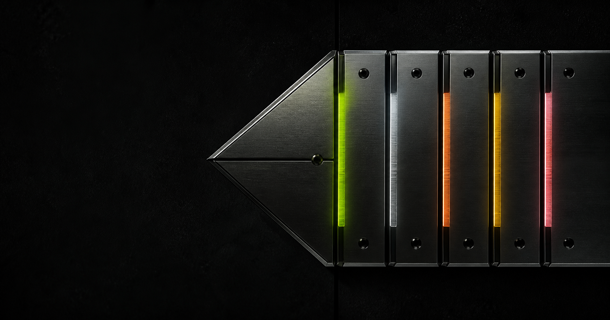

# Gorilla Five Signals



An independent, non-commissioned portfolio concept for Gorilla Energy
Uzbekistan. The experience reframes five products as five distinct signal
worlds through authored typography, product theatre, responsive interaction,
and finite motion.

[Open the live concept](https://samandarmansurkhodjaev2713.github.io/gorilla-five-signals-concept/) ·
[Visit the official Gorilla Uzbekistan website](https://www.gorillaenergy.uz/?locale=uz)

> This repository is a design and engineering study. It is not an official
> Gorilla Energy website and does not claim endorsement, commission, or
> affiliation.

## Current status

The public Pages build is a stable review baseline. The active feature branch
adds the authored Product Atlas, Signal Duel, and five distinct product-detail
worlds; final cross-engine, Lighthouse, physical-device, and legal screenshot
sign-off remain open. The concept is not presented as a finished commercial
release.

## Experience

- Five localized product worlds plus an authored frequency-based Product Atlas.
- A responsive Signal Duel that preserves up to three selected products on
  every viewport.
- Uzbek, Russian, and English routes with canonical, alternate, and sitemap
  metadata.
- Full, lite, paused, reduced-motion, and no-script experience paths.
- Keyboard-operable product exploration, comparison, locator, and navigation.
- Base-path-safe static output for project-level GitHub Pages hosting.
- Original industrial material studies combined with permission-controlled
  product packshots.

## Stack

- Astro 7 with strict TypeScript and static output
- GSAP for finite, context-scoped motion choreography
- Zod for environment and content-boundary validation
- Vitest, Playwright, Axe, and Lighthouse for release evidence
- pnpm with pinned Node.js and package-manager versions

## Run locally

```bash
corepack enable
pnpm install --frozen-lockfile
pnpm dev
```

Use Node.js 24.16.0 from `.node-version`/`.nvmrc` before running these commands.

The local site opens at `http://localhost:4321/` and redirects to the Uzbek
route by default.

## Quality gates

```bash
pnpm quality
pnpm exec playwright test --project=chromium
pnpm test:lighthouse
```

`pnpm quality` checks formatting, linting, strict types, unit coverage, the
static build, links, budgets, content integrity, font and media provenance,
the SBOM, dependency licenses, and high-severity dependency advisories.
The host-specific film generator is verified only on its registered Windows
toolchain; the Linux Pages builder verifies immutable shipped-media checksums
and never regenerates release media.

## Architecture

```text
src/
├── components/       # semantic page and product compositions
├── config/           # validated environment and site contracts
├── content/          # localized, schema-validated product content
├── features/         # bounded interaction and domain modules
├── layouts/          # metadata, responsible entry, and global shell
├── motion/           # preferences, scenes, transitions, and runtime
├── pages/            # localized static route surface
├── scripts/          # browser entry points and lifecycle coordination
└── styles/           # tokens, typography, reset, and shared primitives
tests/
├── unit/             # domain and boundary tests
└── e2e/              # responsive, interaction, a11y, and visual evidence
docs/                 # decisions, product direction, QA, and provenance
```

Start with the [concept direction](docs/product/GORILLA_CONCEPT.md),
[target architecture](docs/architecture/TARGET_ARCHITECTURE.md),
[engineering standard](docs/quality/ENGINEERING_STANDARD.md), and
[asset provenance ledger](docs/content/ASSET_PROVENANCE.md).

## Deployment

Every push to `main` builds a fresh public artifact and deploys it with the
official GitHub Pages actions. The public build sets an explicit origin and
repository base path; source code never hardcodes the hosting subdirectory.

`main` requires a pull request, an up-to-date branch, successful source-quality
and CodeQL checks, and resolved review conversations. Force pushes and branch
deletion are disabled, including for administrators. These automated checks do
not replace browser, visual, performance, or legal release approval. See the
[GitHub configuration record](docs/release/GITHUB_CONFIGURATION.md).

GitHub Pages does not apply the repository's Cloudflare-style `_headers` file.
Document-level CSP and referrer fallbacks remain active, while HSTS and other
response headers depend on GitHub's hosting edge and are not claimed as
application-controlled guarantees.

## Rights and provenance

The original interface, motion choreography, generated artwork, and writing are
All Rights Reserved. Gorilla names, trademarks, logos, and official product
imagery remain the property of their respective owners. Dependency and font
licenses remain their own.

See [LICENSE](LICENSE), [NOTICE.md](NOTICE.md),
[THIRD_PARTY_NOTICES.md](THIRD_PARTY_NOTICES.md), and the
[CycloneDX SBOM](docs/release/SBOM.cdx.json).
